# kUtRL : guide d'utilisation

_kUtRL_ (« Réducteur de liens ») permet de créer des liens courts pour votre blog : depuis l'administration, depuis un billet, depuis les contenus ou depuis une page publique. Les liens courts peuvent être servis par votre propre blog ou par un service externe.

## Sommaire

1. [Activer et configurer le plugin](#activer-et-configurer-le-plugin)
2. [Les services](#les-services)
3. [La liste des liens](#la-liste-des-liens)
4. [Créer un lien court](#créer-un-lien-court)
5. [Liens courts des billets](#liens-courts-des-billets)
6. [Page publique et widgets](#page-publique-et-widgets)
7. [Balises de thème et contenus](#balises-de-thème-et-contenus)
8. [Préférences](#préférences)
9. [Avec un assistant IA](#avec-un-assistant-ia)

## Activer et configurer le plugin

Allez dans **Système › Gestion des plugins**, déroulez _kUtRL_ puis cliquez sur **Configurer le plugin**. Vous pouvez aussi utiliser le lien **Configurer le plugin** en bas de la liste des liens.

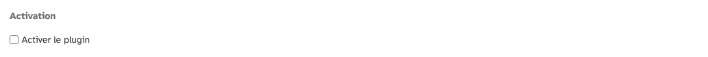

Cochez **Activer le plugin** et enregistrez. Le menu **Réducteur de liens** apparaît dans le menu **Plugins**.

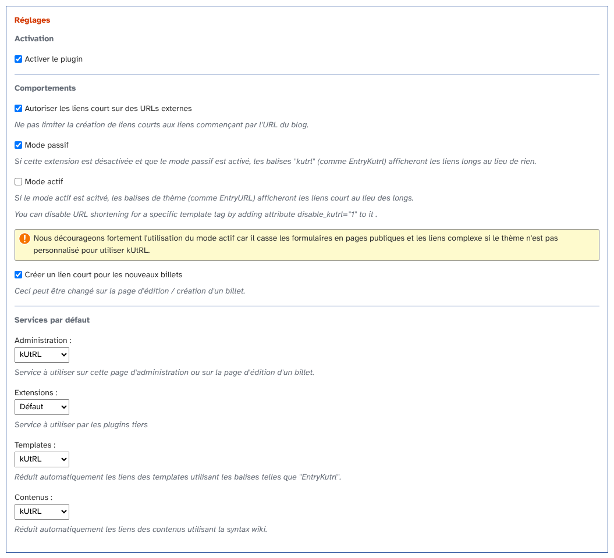

- **Autoriser les liens court sur des URLs externes** : sans cette case, seuls les liens commençant par l'adresse de votre blog peuvent être réduits.
- **Mode passif** : si le plugin est désactivé, les balises « kutrl » des thèmes (comme `EntryKutrl`) affichent le lien long au lieu de rien.
- **Mode actif** : les balises de thème habituelles (comme `EntryURL`) affichent des liens courts. Ce mode est déconseillé : il peut casser les formulaires publics et les liens complexes si le thème n'est pas adapté.
- **Créer un lien court pour les nouveaux billets** : la case correspondante est cochée par défaut sur la page d'un nouveau billet (vous pouvez la changer billet par billet).
- **Services par défaut** : le service utilisé pour l'administration et les billets, pour les plugins tiers, pour les balises de thème et pour les contenus (syntaxe wiki).

Chaque service peut être testé : après l'enregistrement, une coche verte ou rouge indique s'il fonctionne.

## Les services

Plus bas dans la configuration, chaque service a ses propres réglages.

- **kUtRL** : votre blog réduit et sert lui-même les liens (adresse `…/go/<lien>`).
- **Default**, **is.gd**, **bit.ly**, **BilboLinks**, **YOURLS** et **Custom** : services externes (ou votre propre serveur) ; renseignez l'adresse de leur API et, selon le service, un identifiant ou une clé.

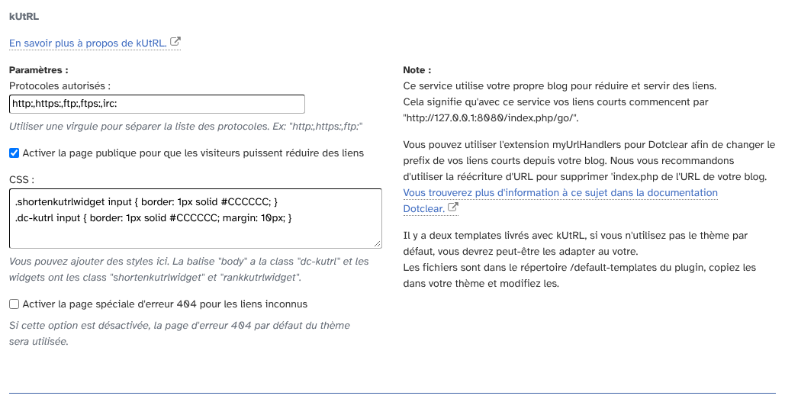

Pour le service **kUtRL** :

- **Protocoles autorisés** : la liste des débuts d'adresse acceptés (par exemple `http:,https:`).
- **Activer la page publique** : les visiteurs peuvent alors réduire des liens sur la page `/go` du blog.
- **CSS** : style de la page publique et des widgets.
- **Page spéciale d'erreur 404** : affiche une page d'erreur propre à kUtRL pour les liens inconnus, au lieu de celle du thème.

Le plugin livre deux modèles de page (`kutrl.html` et `kutrl404.html`) dans son dossier `default-templates` : copiez-les dans votre thème pour les adapter. Avec le plugin _myUrlHandlers_, vous pouvez changer le préfixe `go` des liens courts.

## La liste des liens

Le menu **Plugins › Réducteur de liens** affiche tous les liens courts du blog.

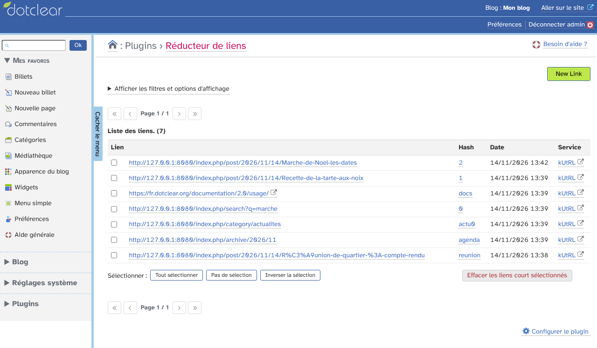

Cliquez sur le lien long pour l'ouvrir, sur le hash pour suivre le lien court. Le bouton **Afficher les filtres et options d'affichage** permet de filtrer par service et de choisir le nombre de liens par page.

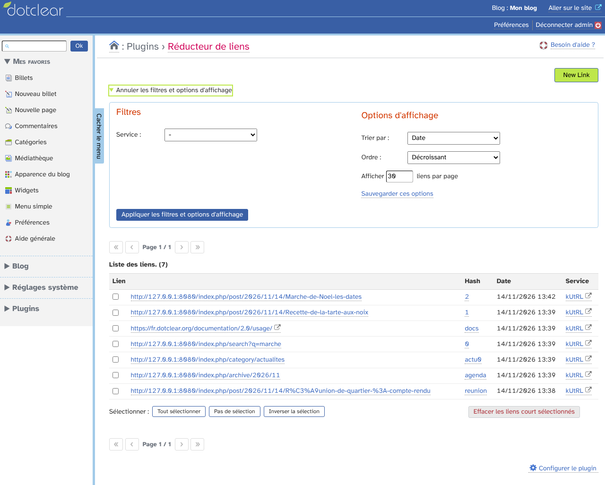

Cochez des liens puis **Effacer les liens court sélectionnés** pour les supprimer.

## Créer un lien court

Cliquez sur **New Link**.

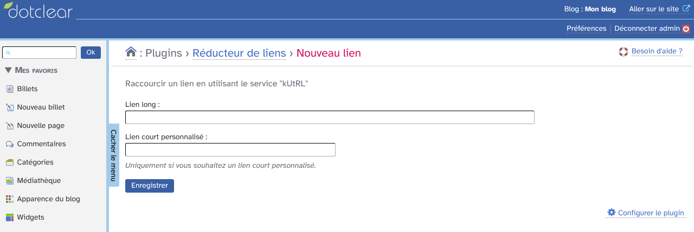

Saisissez le **Lien long**. Si le service le permet, vous pouvez choisir votre **Lien court personnalisé**. Avec le service kUtRL, un lien comme `actu!!` est « semi-personnalisé » : il commence par `actu` et `!!` est remplacé par un numéro.

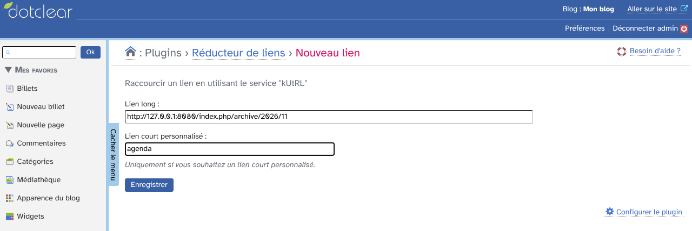

Après l'enregistrement, le lien court est affiché. Si le lien long a déjà un lien court, c'est celui-ci qui est rappelé.

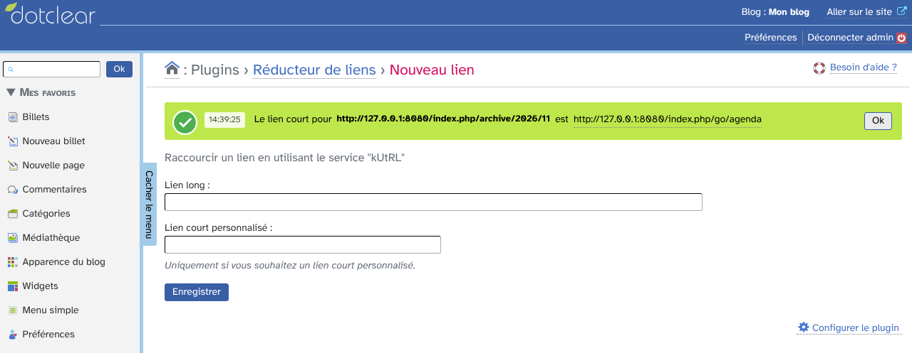

Un lien est refusé s'il n'est pas valide, s'il est plus court que le lien court qu'il remplacerait, si son protocole n'est pas autorisé, s'il est externe alors que ce n'est pas permis, ou s'il est déjà un lien court.

## Liens courts des billets

Sur la page d'un billet, la section **Lien court** de la colonne de droite permet de créer le lien court du billet (avec un lien personnalisé si le service le permet).

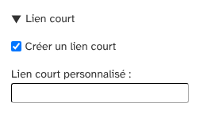

Quand le billet a déjà un lien court, il est affiché, avec la case **Effacer un lien court**.

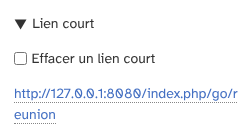

Sur la liste des billets, les actions **Créer un lien court** et **Effacer un lien court** (menu **Réducteur de liens**) agissent sur plusieurs billets à la fois. Elles sont réservées aux administrateurs.

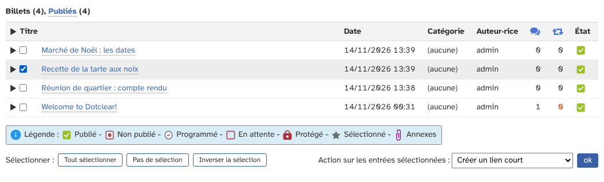

## Page publique et widgets

Si la page publique est activée dans le service kUtRL, vos visiteurs peuvent réduire un lien à l'adresse `/go` de votre blog. Un champ anti-robot leur demande de recopier un court texte.

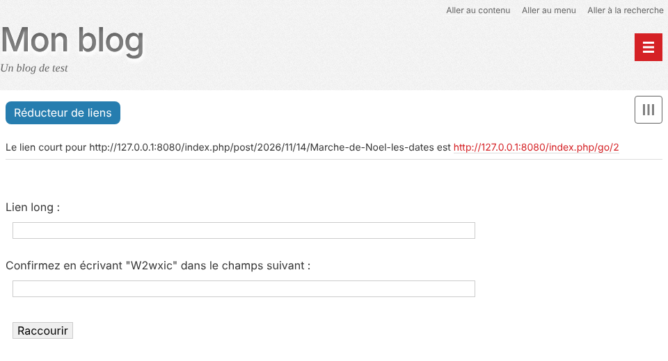

Deux widgets sont disponibles dans **Apparence du blog › Widgets** :

- **Réducteur de liens** : le formulaire de réduction de liens ;
- **Top des liens courts** : les liens les plus suivis (texte, tri, limite et type de liens réglables ; vous pouvez cacher les liens jamais suivis).

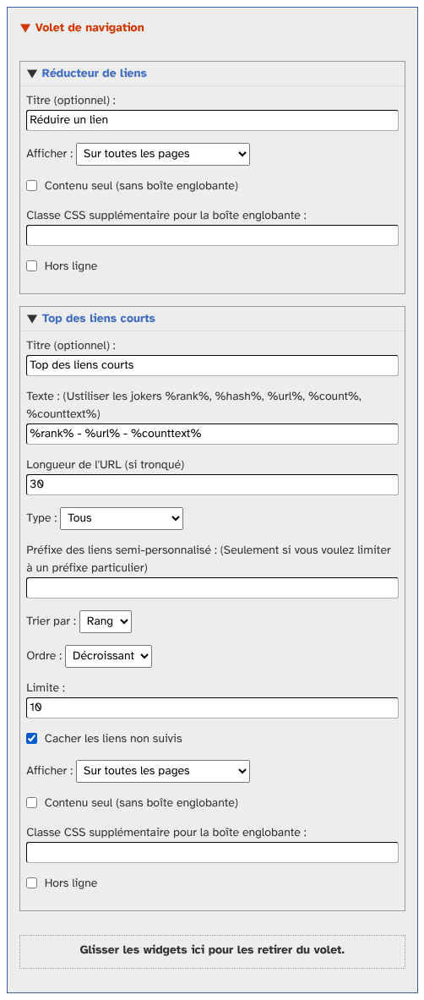

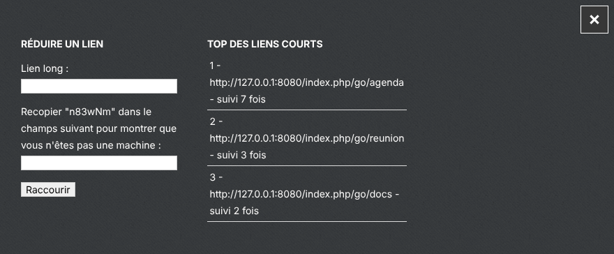

## Balises de thème et contenus

- Les balises `EntryKutrl`, `EntryAuthorKutrl`, `CommentAuthorKutrl`, `CommentPostKutrl`, `AttachmentKutrl` et `MediaKutrl` affichent le lien court de l'adresse concernée ; chacune a une balise `…KutrlIf` pour la tester. Ajoutez `disable_kutrl="1"` à une balise pour désactiver la réduction à cet endroit.
- Les liens écrits en syntaxe wiki dans les billets et les commentaires sont réduits automatiquement avec le service choisi pour les **Contenus**.

## Préférences

Dans **Préférences › Mes options**, vous pouvez choisir les colonnes affichées dans la liste des liens et leur ordre, ainsi que le tri et le nombre de liens par page.

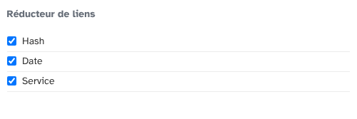

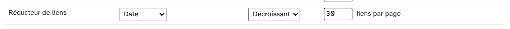

## Avec un assistant IA

Avec le plugin [ClaudetteMcp](https://github.com/JcDenis/ClaudetteMcp), un assistant IA connecté au blog peut gérer les liens courts,
si le plugin est activé et si vous êtes administrateur du blog :

* `list_short_links` : lister les liens courts avec leur adresse longue et leur nombre de visites ;
* `create_short_link` : créer un lien court, avec le service choisi pour l'administration et les mêmes vérifications que la page de création d'un lien court.

Si l'adresse a déjà un lien court, l'assistant le retrouve au lieu d'en créer un autre. Il ne supprime jamais de lien.
_ClaudetteMcp_ n'est pas nécessaire au fonctionnement de _kUtRL_.
